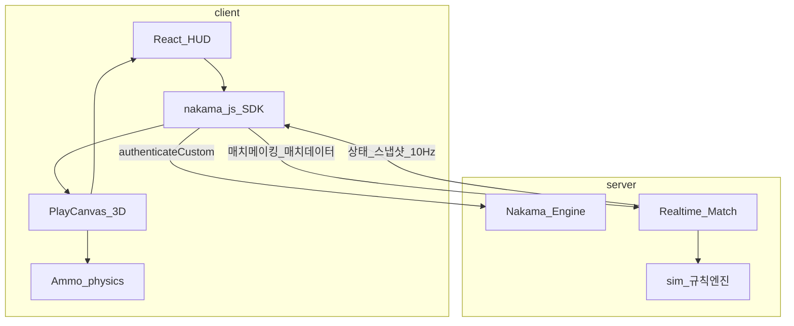

# 스타프론트 (StarFront) MVP 게임 기획서

| 항목 | 내용 |
|------|------|
| 문서 버전 | 0.8 (MVP) |
| 장르 | 세로형 모바일 실시간 전략 (RTS-lite) |
| 플랫폼 | **웹게임** (모바일 브라우저 우선, PC 브라우저도 동일 세로 비율로 플레이) |
| 대전 | 온라인 실시간 1v1 PvP |
| 상태 | 플레이테스트용 초안 수치 포함 |

---

## 1. 개요

### 1.1 한 줄 컨셉

세로형 모바일 전장에서 건물만 배치·생산하고, **유닛을 직접 조작하지 않은 채** 자동 전진·교전으로 상대 사령부를 파괴하는 실시간 전략 게임.

### 1.2 레퍼런스와 차별점

| 레퍼런스 | 가져올 것 | 가져오지 않을 것 |
|----------|-----------|------------------|
| 스타크래프트형 RTS | 3종족, 사령부·일꾼·생산 건물, 자원 채취 | 유닛 직접 컨트롤, 복잡한 테크트리 |
| 클래시로얄형 | 세로 전장, 양 끝 기지, 짧은 매치 템포, 터치 중심 UI | 카드 덱, 엘릭서 단일 자원만 |

**핵심 차별점**

- 플레이어 입력은 **건물 배치 / 생산 큐 / 랠리포인트**만 허용한다.
- 생성된 전투 유닛은 기본적으로 적 사령부 방향으로 이동하며, 건물마다 지정한 랠리포인트를 경유할 수 있다.
- 유닛별 체력·공격력·사거리·공격 유형에 따라 자동으로 이동·공격한다.

### 1.3 MVP 목표

3종족 최소 로스터로 **온라인 1v1 코어 루프**(수집 → 건설 → 생산 → 자동 교전 → 승패)를 검증한다.

---

## 2. 코어 루프

1. 매치 시작: 양 진영 사령부·시작 일꾼·에너지 초기값 지급
2. 에너지 자동 충전 + 일꾼이 미네랄 노드 자동 채취
3. 생산 건물 건설 → 전투 유닛 생산 → 랠리포인트로 진출 경로 조절
4. 유닛 자동 이동·교전
5. 상대 사령부 HP 0이면 승리

### 2.1 승패 규칙

| 조건 | 결과 |
|------|------|
| 상대 사령부 HP ≤ 0 | 승리 |
| 아군 사령부 HP ≤ 0 | 패배 |
| 제한시간 종료 | 사령부 **남은 HP 비율**이 높은 쪽 승리 |
| 제한시간 종료 + HP 비율 동일 | 무승부 |

- **매치 제한시간**: 4분 00초 (목표 체감 3~5분)
- 더블 코스트 / 오버타임은 MVP Out of Scope (추후 검토)

---

## 3. 전장·카메라

### 3.0 좌표계 (MVP)

PlayCanvas **3D 씬**을 쓰되, MVP 게임플레이는 **탑뷰 2D**로 취급한다.

| 축 | MVP 사용 | 의미 |
|----|----------|------|
| **X** | 사용 | 맵 가로 (레인 좌우) |
| **Y** | 고정(높이 상수) | 지면 높이. 이동·배치·심에 쓰지 않음 |
| **Z** | 사용 | 맵 세로 (아군↔적 진영 방향) |

- 서버 스냅샷·건설 격자·이동 AI·사거리는 모두 **(x, z)** 만 다룬다.
- 엔티티 `y`는 지면 오프셋 상수(예: 0). 점프·비행 고도는 Out of Scope.
- 카메라: **XZ 평면을 내려다보는 orthographic(또는 거의 수직 perspective) 탑뷰**. 이후 3D 연출(틸트·높이 차)로 확장 가능하도록 씬만 3D로 둔다.

### 3.1 맵 구조

- **세로형** 전장(주로 **Z축** 길이). 플레이어는 화면 하단 진영(−Z 또는 +Z 중 한쪽), 상대는 반대쪽(클라이언트에서 시야 반전 가능).
- 양 끝단에 각 진영 **사령부** 고정 배치.
- 맵은 Z 방향으로 스크롤해 전장을 확인한다. 미니맵은 MVP에서 **선택(권장: 우측 소형 미니맵)**.

### 3.2 구역

| 구역 | 설명 |
|------|------|
| 아군 기지 구역 | 사령부 주변. 시작 시 건설 가능 |
| 아군 확장 구역 | 전방 방향으로 이어지는 건설 가능 띠 |
| 중립 교전 구역 | 중앙. MVP에서는 건물 건설 **불가** |
| 적 구역 | 건설 불가 |

**건설 규칙 (MVP)**

- 아군 기지·확장 구역의 **빈 격자**에만 건물 배치 가능.
- 다른 건물·미네랄 노드·사령부와 충돌하는 칸에는 배치 불가.
- 격자 크기 초안: 맵 가로 7칸 × 세로 14칸 (진영당 대략 세로 5칸 건설 가능).

### 3.3 미네랄 노드

| 위치 | 개수 | 비고 |
|------|------|------|
| 각 진영 전방(기지와 중립 사이) | 진영당 2개 | 대칭 배치 |
| 노드당 총량 | 800 | 고갈 시 해당 노드 채취 불가 |
| 동시 채취 일꾼 | 노드당 최대 2 | 초과 일꾼은 다른 노드로 재할당 |

---

## 4. 자원·경제

### 4.1 자원 정의 (혼합형)

| 자원 | 획득 | 용도 |
|------|------|------|
| **에너지** | 시간 경과로 자동 충전 | 모든 건물·유닛 생산의 **필수** 비용 |
| **미네랄** | 일꾼이 노드 자동 채취 | 생산 건물·전투 유닛의 **추가** 비용. 일꾼 생산에는 불필요 |

역할을 분리한다. 에너지는 매치 템포를, 미네랄은 일꾼·채취 투자의 보상을 담당한다.

### 4.2 에너지

| 항목 | 수치(초안) |
|------|------------|
| 시작 에너지 | 5 |
| 최대 에너지(캡) | 10 |
| 충전 속도 | 1초당 0.1 (10초에 1) |
| 표시 | 정수로 반올림 표시, 소모는 정수 단위 |

### 4.3 미네랄·일꾼 채취

| 항목 | 수치(초안) |
|------|------------|
| 시작 미네랄 | 50 |
| 일꾼 1회 운반량 | 8 |
| 채취~귀환 왕복(평균) | 약 4초 |
| 일꾼당 분당 예상 수입 | 약 120 (이론치, 이동 거리 따라 변동) |

**일꾼 AI (플레이어 명령 없음)**

1. 생산 직후 가장 가까운 **여유 슬롯이 있는** 아군 측 미네랄 노드로 이동
2. 채취 완료 → 아군 사령부로 귀환 → 미네랄 적립 → 동일 노드로 복귀
3. 노드 고갈 또는 슬롯 초과 시 다음 최단 노드로 재할당
4. 전투 유닛과 달리 적 방향으로 전진하지 않음. 적에게 공격받으면 도주하지 않고 현 작업 유지(MVP 단순화)

### 4.4 비용 규칙

- 비용 부족 시 해당 행동(건설/생산) 시작 불가.
- 건설·생산 시작 시점에 비용을 **즉시 차감**.
- 취소 시 환불: MVP에서는 **건설 중 취소 시 에너지·미네랄 50% 환불**, 생산 큐 취소 시 **100% 환불**(큐에서 제거만 하는 경우).

---

## 5. 건물·생산·랠리

### 5.1 건물 공통

| 항목 | 규칙 |
|------|------|
| 배치 | 빌드 메뉴에서 선택 → 맵에 고스트 드래그 → 유효 칸에서 확정 |
| 건설 시간 | 배치 후 HP 0→최대까지 진행. 건설 중에도 적에게 공격받을 수 있음 |
| 파괴 | HP 0 시 제거. 사령부 파괴 시 매치 종료 |
| 선택 | 탭으로 선택 → 생산 버튼·랠리 표시 |

### 5.2 사령부

- 매치 시작 시 고정 존재. **추가 건설 불가**(MVP).
- **일꾼만** 생산 가능.
- 랠리포인트: 일꾼은 랠리를 무시하고 채취 AI를 따름(사령부 랠리 UI는 비활성).

### 5.3 기본 생산 건물

- 종족당 1종. 아군 구역에 건설.
- **기본 전투 유닛만** 생산.
- 건물당 생산 큐 길이: 최대 5.
- 동일 건물을 여러 채 건설 가능(에너지·미네랄·자리만 허용되면).

### 5.4 랠리포인트

| 항목 | 규칙 |
|------|------|
| 개수 | 생산 건물당 1개 |
| 지정 | 건물 선택 후 맵 탭. 아군·중립·적 구역 모두 지정 가능 |
| 기본값 | 건물 전방(적 사령부 방향) 짧은 거리 |
| 유닛 행동 | 생산 완료 → 랠리 지점까지 이동 → 이후 적 사령부 방향 직선 전진 |
| 변경 | 즉시 반영. **이미 나온 유닛**의 경로는 변경되지 않음(이후 생산분부터 적용) |

---

## 6. 유닛·전투

### 6.1 공통 스탯

| 스탯 | 설명 |
|------|------|
| HP | 체력. 0이면 사망 |
| 공격력 | 1회 공격 피해 |
| 공격 주기 | 공격 간격(초) |
| 공격 범위 | 이 거리 안 적 공격 |
| 공격 유형 | `지상만` / `공중만` / `모두` |
| 유닛 유형 | `지상` / `공중` (MVP 실전 유닛은 전부 지상) |
| 이동 속도 | 초당 XZ 격자 비율 이동 (Y 미사용) |

### 6.2 이동·전투 AI

플레이어는 이동·공격 명령을 내리지 않는다.

1. **이동**: XZ 평면에서 랠리 미도달 시 랠리로 이동. 도달 후 적 사령부 (x,z)를 향한 직선 이동.
2. **교전 감지**: 공격 범위 내 적 발견 시 정지하고 공격.
3. **타겟 우선순위** (동률 시 거리 가까운 순):
   1. 공격 가능한 적 전투 유닛
   2. 적 생산 건물(건설 중 포함)
   3. 적 일꾼
   4. 적 사령부
4. 타겟 사망·이탈 시 우선순위로 재탐색. 없으면 다시 적 사령부 방향 이동.
5. 공격 유형이 맞지 않는 대상은 무시(예: `지상만`은 공중 유닛 미공격). MVP에는 공중 유닛이 없으나 필드·로직은 구현한다.

### 6.3 충돌·길막 (MVP)

- 아군끼리 약한 밀어내기(소프트 충돌).
- 완전 블로킹·어택땅 마이크로는 없음.
- 건물·사령부는 단단한 장애물.

---

## 7. 종족 편성 (MVP)

저작권 이슈를 피하기 위해 **오리지널 가칭**을 사용한다. 아키타입만 SC형 3종족을 참고한다.

| 종족 | 판타지 | 사령부 | 일꾼 | 생산 건물 | 기본 전투 유닛 |
|------|--------|--------|------|-----------|----------------|
| **인간 (테란 아키타입)** | 균형·방호 | 전초기지 | 공병 | 훈련소 | 돌격병 |
| **괴물 (저그 아키타입)** | 물량·속도 | 군체 | 일벌 | 부화장 | 날개발톱 |
| **외계인 (프로토스 아키타입)** | 단단함·순간 힘 | 성역 | 탐사정 | 소환문 | 수호기사 |

### 7.1 종족별 역할 감각 (밸런스 방향)

기본 전투 유닛은 스타크래프트(브루드워) **마린 / 저글링 / 질럿**과 같은 역할·상대 비율로 맞춘다. 고유명·공식 수치는 쓰지 않고, HP·이동·공격주기·사거리의 **상대 밸런스**를 이식한다.

| 종족 | 기본 유닛 | SC 아키타입 | 특성 | 경제 감각 |
|------|-----------|-------------|------|-----------|
| 인간 | 돌격병 | 마린 | 낮은 HP, 중거리 사격, 표준 이동 | 표준 |
| 괴물 | 날개발톱 | 저글링 | 최저 HP, 최단 사거리(근접), 최고 이동·공격속도, 저비용 | 생산이 약간 빠름 |
| 외계인 | 수호기사 | 질럿 | 높은 유효 HP, 근접 강타(2연타), 마린과 동일 이동 | 미네랄·생산시간 부담 큼 |

---

## 8. UI / 조작 (모바일)

### 8.1 HUD

| 요소 | 위치 | 내용 |
|------|------|------|
| 에너지·미네랄 | 상단 | 현재 / 캡(에너지만) |
| 아군·적 사령부 HP | 상단 또는 각 기지 위 | 바 + 숫자 |
| 매치 타이머 | 상단 중앙 | 남은 시간 |
| 빌드/생산 바 | 하단 | 건설 가능 건물, 선택 건물 생산 버튼 |
| 미니맵 | 우측 | 탭 시 카메라 이동(권장) |

### 8.2 입력

| 입력 | 동작 |
|------|------|
| 빈 맵 드래그 | 카메라 스크롤 |
| 건물 아이콘 → 드래그 | 배치 고스트. 유효=청색, 무효=적색 |
| 건물 탭 | 선택. 생산·랠리 UI |
| 선택 상태에서 맵 탭 | 랠리포인트 지정 |
| 생산 버튼 | 큐에 추가(자원 충분 시) |
| 큐 아이콘 롱프레스 | 큐 취소(환불 규칙 적용) |

**금지 입력**: 유닛 탭으로 이동·공격·홀드 등 직접 명령.

---

## 9. 온라인 PvP 요구사항 (기획)

### 9.1 매치 흐름

1. **게스트 로그인** (`authenticateCustom`) → 세션 확보
2. 로비에서 빠른 대전 → Nakama 매치메이킹
3. 종족 선택(또는 사전 선택) → 매치(Realtime) 참가·로딩
4. 양쪽 준비 완료 후 동일 시점에 매치 시작
5. 종료 후 결과 화면(승/패/무, 사령부 HP, 기본 통계)

### 9.1.1 인증 (MVP)

| 항목 | 결정 |
|------|------|
| 방식 | Nakama **`authenticateCustom`** (게스트) |
| 클라 | `@heroiclabs/nakama-js` SDK |
| ID | 브라우저에 저장한 `customId`(UUID). 없으면 생성 후 `localStorage` 등에 보관해 재방문 시 동일 계정 유지 |
| 세션 | SDK 세션 토큰 저장·만료 시 재인증 |
| Out of Scope | 이메일/소셜 로그인, 계정 연동 UI (추후 `authenticate*` 확장) |

### 9.2 동기화 원칙

| 항목 | MVP 결정 |
|------|----------|
| 권위 | **서버 권위(server-authoritative)** |
| 동기화 대상 입력 | 건물 배치, 생산 큐 추가/취소, 랠리포인트 변경만 |
| 유닛 이동·전투 | 서버 시뮬레이션 결과 스냅샷/델타를 클라이언트에 반영 |
| 클라이언트 예측 | **최소화**. 로컬 고스트·UI만 즉시 반응, 판정은 서버 |
| 틱 | 고정 틱 초안 **10 Hz** (0.1초). 밸런스·체감에 따라 조정 |
| 치트 방지 | 비용·건설 유효성·사거리는 서버에서 검증 |

### 9.3 매치메이킹·접속 (MVP)

| 기능 | MVP |
|------|-----|
| 1v1 빠른 대전 | 포함 (Nakama Matchmaker) |
| 레이턴시 기준 근접 매칭 | 포함(단순: 리전 고정 1개여도 가능) |
| 랭크/시즌 MMR | Out of Scope (내부 히든 레이팅만 단순 가능) |
| 관전 | Out of Scope |
| 리커넥트 | **짧은 재접속(예: 30초) 허용** 권장. 실패 시 패배 처리 |
| 친구 초대·커스텀 룸 | Out of Scope |

### 9.4 네트워크 실패

- 한쪽 장시간 무응답: 서버가 해당 플레이어 패배 처리 후 매치 종료.
- 양쪽 동시 문제: 무승부 또는 매치 무효(운영 정책으로 서버에 기록).

---

## 10. MVP 범위 / Out of Scope

### 10.1 In Scope (MVP)

- 인간·괴물·외계인 3종족, 각 사령부·일꾼·생산 건물 1·전투 유닛 1
- 혼합 자원(에너지 + 미네랄)
- 무조작 자동 이동·전투, 건물 랠리포인트
- 세로형 대칭 1맵
- 온라인 실시간 1v1, 서버 권위 시뮬레이션
- 기본 HUD·배치·생산·랠리 UI
- 승패·시간 종료 판정

### 10.2 Out of Scope

- 추가 테크 건물, 업그레이드, 마법·영웅
- 공중 유닛 실배치(스탯 필드만 예약)
- 시야 안개·클로킹·탐지
- 맵 다수, 2v2, AI 캠페인
- 카드/덱 시스템
- 클랜, 시즌 랭크 UI, 상점·배틀패스
- 더블 코스트·엘릭서 급가속 페이즈
- 리플레이 공유, 토너먼트

---

## 11. 수치·밸런스 초안 부록

> 모든 수치는 플레이테스트 시작값이다. 체감 템포(첫 교전 ~60~90초, 결전 ~3분)를 기준으로 조정한다.

### 11.1 사령부

| 종족 | 이름 | HP | 공격 | 비고 |
|------|------|-----|------|------|
| 인간 | 전초기지 | 3000 | 없음(MVP) | 파괴 시 패배 |
| 괴물 | 군체 | 3000 | 없음 | 동일 |
| 외계인 | 성역 | 3000 | 없음 | 동일 |

### 11.2 일꾼

| 종족 | 이름 | 비용(에너지/미네랄) | 생산시간 | HP | 이동속도 | 공격 | 공격유형 |
|------|------|---------------------|----------|-----|----------|------|----------|
| 인간 | 공병 | 2 / 0 | 8초 | 40 | 1.0 | 없음 | — |
| 괴물 | 일벌 | 2 / 0 | 7초 | 35 | 1.1 | 없음 | — |
| 외계인 | 탐사정 | 2 / 0 | 8초 | 45 | 1.0 | 없음 | — |

- 시작 일꾼: 각 진영 **3기**
- 일꾼 인구/상한: MVP에서는 **별도 인구수 없음**. 대신 실용 상한은 미네랄 슬롯(진영당 노드 2×슬롯 2 = 4) + 잉여 일꾼 비효율로 조절

### 11.3 생산 건물

| 종족 | 이름 | 비용(E/M) | 건설시간 | HP | 생산 유닛 |
|------|------|-----------|----------|-----|-----------|
| 인간 | 훈련소 | 4 / 40 | 12초 | 600 | 돌격병 |
| 괴물 | 부화장 | 3 / 35 | 10초 | 500 | 날개발톱 |
| 외계인 | 소환문 | 5 / 50 | 14초 | 700 | 수호기사 |

### 11.4 기본 전투 유닛

**밸런스 기준**: 스타크래프트 브루드워 마린 / 저글링 / 질럿.  
**이동속도 정규화**: 마린(BW 4.00) = **1.00**. 사거리는 BW 지상 사거리 단위를 맵 격자 단위로 그대로 사용(근접 1, 마린 4).

| 종족 | 이름 | 아키타입 | 비용(E/M) | 생산시간 | HP | 공격력 | 공격주기 | DPS(참고) | 사거리 | 이동속도 | 유닛유형 | 공격유형 |
|------|------|----------|-----------|----------|-----|--------|----------|-----------|--------|----------|----------|----------|
| 인간 | 돌격병 | 마린 | 3 / 50 | 6초 | 40 | 6 | 0.63초 | ≈9.5 | 4 | 1.00 | 지상 | 지상만 |
| 괴물 | 날개발톱 | 저글링 | 2 / 25 | 4.5초 | 35 | 5 | 0.34초 | ≈14.9 | 1 | 1.37 | 지상 | 지상만 |
| 외계인 | 수호기사 | 질럿 | 5 / 100 | 10초 | 160 | 8×2 | 0.92초 | ≈17.4 | 1 | 1.00 | 지상 | 지상만 |

**수호기사 HP 160**: BW 질럿 HP 100 + 실드 60을 MVP에서 **단일 HP로 합산**. 실드 재생·분리 UI는 Out of Scope.

**수호기사 8×2**: 한 공격 주기마다 8 피해를 2회(총 16) 적용. 구현 시 한 틱에 합산 처리해도 무방하나, 표시·로그는 2연타로 둔다.

**비용 비율**: SC 미네랄 50 / 25 / 100에 맞춰 미네랄 비용을 50 / 25 / 100으로 맞춤. 에너지는 템포용으로 3 / 2 / 5.

**맞다이 감(참고, 업그레이드·아머 없음)**  
- 돌격병 vs 날개발톱: 원거리 선공. 링이 붙으면 DPS로 압도하나 접근 전 손실 발생.  
- 돌격병 vs 수호기사: 사거리로 깎다 붙이면 수호기사가 유리.  
- 날개발톱 vs 수호기사: 물량으로 둘러싸야 함. 소수로는 수호기사 유리.

### 11.5 예상 타이밍 (가이드)

| 시점 | 기대 행동 |
|------|-----------|
| 0:00 | 시작 일꾼 3이 미네랄 채취. 에너지 충전 대기 |
| 0:20~0:40 | 첫 생산 건물 건설 |
| 0:50~1:30 | 첫 전투 유닛 교전·견제 |
| 2:00~3:00 | 생산 건물 추가 또는 일꾼 추가 후 물량 싸움 |
| 3:00~4:00 | 사령부 압박·마무리 |

### 11.6 밸런스 조정 시 우선 손볼 노브

1. 에너지 충전 속도·캡  
2. 전투 유닛 비용(E/M)·생산시간  
3. 사령부 HP·매치 시간  
4. 미네랄 노드 총량·슬롯  

---

## 12. 기술 스택 (확정 방향)

네이티브 앱(Unity 등) 대신 **웹**으로 구현한다. 전장은 PlayCanvas **3D 씬**이지만 MVP 플레이는 **XZ 탑뷰 2D**로 동작한다. PC에서는 화면 중앙에 **모바일 세로 비율(예: 9:16) 스테이지**를 레터박스/필러박스로 고정한다.

### 12.1 확정 스택

| 레이어 | 선택 | 이유 |
|--------|------|------|
| 언어 | **TypeScript** | 클라·서버 런타임/모듈 |
| 저장소 | **단일 레포** (`client/` · `server/` 폴더 분리) | 배포 단위는 폴더별 독립 유지 |
| 3D 엔진 | **PlayCanvas** (엔진 런타임, 스크립트 TS) | 웹 3D. MVP는 engine-only + Vite, XZ 탑뷰 |
| 물리 | **Ammo.js** (PlayCanvas rigidbody / collision) | XZ 충돌·레이캐스트 |
| HUD/로비 UI | **React** (PlayCanvas 캔버스 위 오버레이) | 빌드바·자원·타이머·결과창 |
| 멀티플레이 백엔드 | **Nakama** (Heroic Labs) | 인증·매치메이킹·Realtime 매치·서버 권위 로직 |
| 서버 런타임 | Nakama + **TypeScript/JS 런타임 모듈** (또는 Go 모듈) | 매치 핸들러·`sim` 규칙 엔진 |
| 클라 네트워킹 | **`@heroiclabs/nakama-js`** | `authenticateCustom`, socket, matchmaker, match data |
| 전송 | Nakama Realtime (WebSocket) | 입력·상태 스냅샷 10Hz |
| 호스팅 | 클라 정적 호스팅 + Nakama(Docker / 클라우드) | client·server 각각 배포 |

### 12.2 레포 폴더 구성

| 경로 | 역할 | 주요 내용 |
|------|------|-----------|
| `client/` | 웹 프론트 | React HUD, PlayCanvas+Ammo, **nakama-js**, 스냅샷 보간·표시 |
| `server/` | Nakama 프로젝트 | Docker/설정, **런타임 모듈 + `sim`**, 매치메이킹·매치 핸들러 |
| `docs/` | 기획 | GDD |

**규칙 심 위치**: `server/src/sim` + Nakama match handler에만 둔다.  
**프로토콜**: 매치 op-code / JSON(또는 binary) 페이로드. `protocolVersion` 필드로 클라·서버 맞춤.  
**로컬 개발**: `server`에서 Nakama Docker, `client`에서 Vite. 환경변수 `VITE_NAKAMA_HOST` / `VITE_NAKAMA_PORT` / `VITE_NAKAMA_SERVER_KEY`.

### 12.3 인증·세션 (nakama-js)

1. 앱 기동 시 `customId` 로드 또는 UUID 생성 후 저장  
2. `client.authenticateCustom(customId)` → 세션  
3. `client.createSocket()` + `socket.connect(session)`  
4. 이후 매치메이킹·매치 참가는 동일 세션/소켓 사용  

게스트만 MVP. 디바이스/브라우저를 바꾸면 새 게스트로 취급(계정 복구 UI 없음).

### 12.4 PlayCanvas + Ammo + React 역할 분담

| 담당 | 레포 | 내용 |
|------|------|------|
| **React** | 클라이언트 | 로비, 매칭 UI, HUD, 빌드/생산, 결과 |
| **nakama-js** | 클라이언트 | 인증, 매치메이킹, 매치 송수신 |
| **PlayCanvas** | 클라이언트 | 3D 씬·탑뷰 카메라·유닛/건물(위치 XZ) |
| **Ammo** | 클라이언트 | XZ 충돌·밀림·지면 레이캐스트. Y 고정 |
| **Nakama + `sim`** | 서버 | 에너지/미네랄, 생산, 공격·HP, 승패. **권위는 서버** |

**물리 vs 규칙 (MVP)**  
- 이동·충돌은 클라 Ammo의 **XZ**로 표현하되, **(x,z)·HP·교전 결과의 권위는 Nakama 매치 스냅샷**을 따른다.

### 12.5 화면·카메라·입력

| 항목 | 규칙 |
|------|------|
| 스테이지 비율 | 9:16 고정. PC는 중앙 배치 + 여백 |
| 카메라 | **탑뷰**: +Y에서 XZ 평면을 내려봄. orthographic 권장 |
| 좌표계 | 게임플레이 **X·Z만**. Y는 지면 상수 (§3.0) |
| 입력 | 터치/마우스 → 지면(XZ) 레이캐스트 → (x, z) |
| 안전영역 | notch·홈 인디케이터 inset |

### 12.6 비채택

| 후보 | 이유 |
|------|------|
| Unity / Unreal | 웹 MVP 대비 과함 |
| Colyseus / 자체 WS만 | Nakama로 인증·매치·권위 서버 일원화 |
| Phaser / Pixi (2D) | PlayCanvas 3D 씬 전제 |
| 별도 서버 전용 레포 | `server/` 폴더로 통합 |
| 이메일/소셜 로그인 (MVP) | `authenticateCustom` 게스트만 |

### 12.7 구현 백로그 힌트

**`server/` (Nakama)**  
1. Nakama Docker·설정, TS/JS 런타임 모듈 골격  
2. 매치메이킹 + Realtime match 핸들러  
3. `sim` 에너지·건설·생산·전투·승패  
4. 매치 op-code / 스냅샷 + `protocolVersion`  

**`client/`**  
5. nakama-js: `authenticateCustom` 게스트 + 소켓  
6. React 세로 셸 + PlayCanvas(9:16, 탑뷰·Y고정)  
7. Ammo XZ 충돌·레이캐스트  
8. 매치 데이터 ↔ 엔티티 보간, HUD  
9. 3종족 메시·데이터, 모바일 사파리 점검  

---

## 변경 이력

| 버전 | 일자 | 내용 |
|------|------|------|
| 0.1 | 2026-03-19 | MVP 초안 작성. 온라인 1v1, 혼합 자원, 3종족 최소 로스터 확정 |
| 0.2 | 2026-03-19 | 기본 전투 유닛을 BW 마린·저글링·질럿 비율(HP·이속·공속·사거리)로 재조정 |
| 0.3 | 2026-03-19 | 플랫폼을 웹게임(모바일 세로비 유지)으로 변경, TS·Phaser·Colyseus 스택 명시 |
| 0.4 | 2026-03-19 | 3D·PlayCanvas+Ammo 확정, HUD는 React 유지. Phaser 스택 폐기 |
| 0.5 | 2026-03-19 | 클라/서버 멀티레포로 변경. 규칙 심은 서버 레포에 위치 |
| 0.6 | 2026-03-19 | 3D 씬 유지, MVP는 XZ만 쓰는 탑뷰 2D로 명시 |
| 0.7 | 2026-03-19 | 서버 Nakama, 클라 nakama-js, authenticateCustom 게스트 로그인 |
| 0.8 | 2026-03-19 | 단일 레포로 client/·server/ 폴더 구성 변경 |
