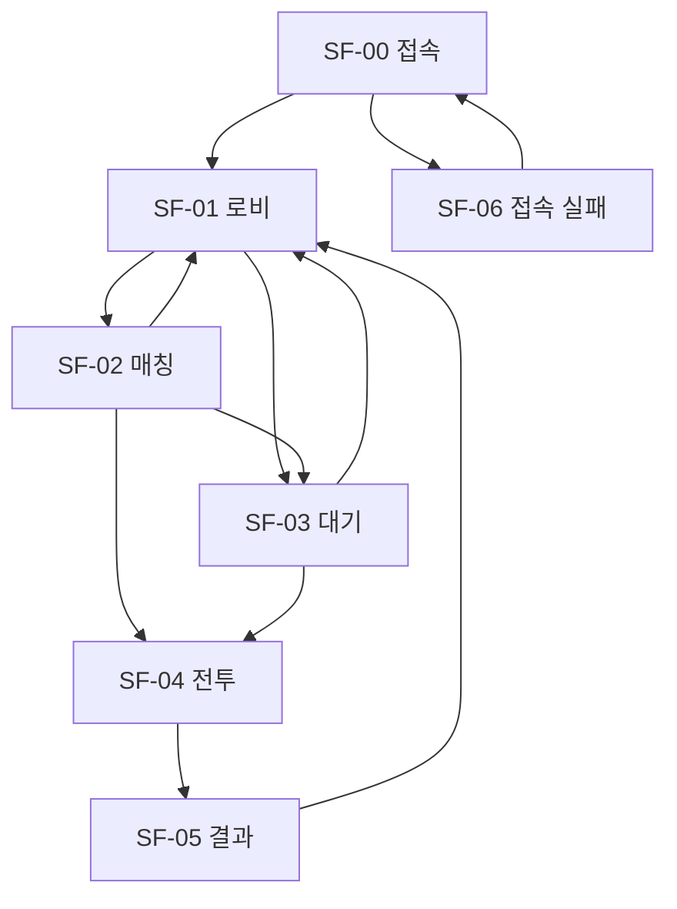

# 스타프론트 UI 기획서 (MVP)

| 항목 | 내용 |
|------|------|
| 문서 버전 | 0.1 |
| 기준 | GDD 0.8, 현재 클라 흐름(게스트 접속 → 로비 → 매치) |
| 플랫폼 | 웹, 9:16 스테이지. PC는 중앙 레터박스 |
| 구현 | `client/src/ui`, `client/src/screens` |

## 1. 목표

플레이어는 유닛을 직접 조종하지 않는다. UI의 일은 **종족을 고르고, 자원을 읽고, 건물을 배치하고, 생산·랠리를 지시**하는 것으로 끝난다.

- Primary job: 4분 1v1에서 건설·생산 지시만으로 상대 사령부를 깨는 것
- Primary user: 모바일 브라우저로 들어오는 플레이테스트 유저
- Success: 로비에서 종족 선택 후 한 번의 탭으로 매칭되고, 전투 중 자원·시간·사령부·건설이 한눈에 읽힌다
- Non-goals: 상점, 랭크, 덱, 계정 연동, 설정 전체 화면, 유닛 직접 명령

톤은 지휘소다. 카드 그리드 대시보드나 보라색 그라데이션 앱 UI로 만들지 않는다.

## 2. 파운데이션

토큰의 기준 파일은 `client/src/ui/tokens.css`다.

### 2.1 컬러 역할

| 역할 | 토큰 | 값 | 용도 |
|------|------|-----|------|
| 배경 | `--bg` | `#07080b` | 레터박스, 페이지 |
| 표면 | `--bg-elev` | `#121710` | 지휘 패널 |
| 본문 | `--ink` | `#efe8d8` | 기본 글자 |
| 보조 | `--ink-dim` | `#a39b8c` | 캡션, 메타 |
| 약한 글자 | `--ink-faint` | `#6e675c` | 비활성 힌트 |
| 선 | `--line` | `rgba(239,232,216,0.16)` | 패널 경계 |
| 강조 선 | `--amber` | `#e4b15a` | 행동, 코너, 에너지 |
| 미네랄 | `--mineral` | `#3ec8c2` | 미네랄 수치·노드 |
| 아군 내구 | `--hp` | `#7dbe6a` | 아군 사령부 |
| 위험 | `--danger` | `#e25b4a` | 적, 시간 임박, 오류 |
| 인간 | `--faction` on `[data-race=human]` | `#9eb6cf` | 종족 식별 |
| 괴물 | `--faction` on monster | `#c5d36a` | 종족 식별 |
| 외계인 | `--faction` on alien | `#6fd0c6` | 종족 식별 |

행동 버튼은 종족과 상관없이 앰버다. 종족색은 선택·식별에만 쓴다. 상태(아군/적/자원)는 색만으로 구분하지 않고 라벨을 붙인다.

### 2.2 타이포

| 역할 | 서체 | 크기 / 무게 | 용도 |
|------|------|-------------|------|
| 로고 | Chakra Petch | 30 / 700, 자간 0.18em | STARFRONT |
| HUD 숫자 | Chakra Petch | 18–28 / 600, tabular-nums | 시간, 자원, 내구 |
| 제목 | Pretendard | 20 / 700 | 화면 제목, 종족 이름 |
| 본문 | Pretendard | 14 / 500, 행간 1.45 | 설명, 버튼 |
| 캡션 | Pretendard | 11 / 600 | 키커, 메타 |

한글은 Pretendard, 로고와 숫자는 Chakra Petch. 시스템 기본 산세리프에 UI를 맡기지 않는다.

### 2.3 공간, 형태, 높이

- 간격 리듬: 4 / 8 / 12 / 16 / 24
- 모서리: 2px. 둥근 앱 카드 대신 금속 코너 브래킷
- 높이: 패널은 얇은 앰버 경계 + 안쪽 하이라이트. 그림자는 떠 있는 카드가 아니라 바닥 밀착
- 터치: 주요 버튼 높이 48px 이상. 입력 글자 16px (모바일 확대 방지)
- 안전 영역: 상단 `safe-area-inset-top`, 하단 `safe-area-inset-bottom`

### 2.4 모션

| 의도 | 동작 | 시간 |
|------|------|------|
| 화면 진입 | 패널이 8px 아래에서 안착 | 220ms |
| 선택 피드백 | 종족 플레이트 왼쪽 바·경계색 | 140ms |
| 위급 | 남은 시간 30초 이하 숫자 색 전환 | 색만, 과한 깜빡임 없음 |

`prefers-reduced-motion`이면 이동·반복 애니메이션을 끈다.

## 3. 정보 구조와 흐름



1. 접속 — 게스트 세션이 열리면 로비
2. 로비 — 종족을 고르고 빠른 대전, 또는 전선을 개설·입장
3. 매칭 — 상대를 찾거나 방에 들어가는 중. 취소하면 로비
4. 대기 — 방에 혼자 있을 때. 상대가 종족을 확정하면 전투
5. 전투 — 자원, 사령부, 타이머, 미니맵, 건설/생산
6. 결과 — 승/패/무, 사령부 내구, 로비 복귀

종족 선택은 별도 화면으로 빼지 않는다. 로비의 첫 결정이고, 빠른 대전의 바로 위에 둔다.

접속·로비·매칭은 `LobbyScene`이다. PlayCanvas는 만들지 않는다. 대기·전투·결과는 `GameScene`이고, 그때만 3D 전장 위에 HUD를 올린다.

## 4. 화면

### SF-00 접속

- 목적: 게스트 인증이 끝날 때까지 빈 버튼 화면을 보이지 않는다
- 진입: 앱 시작 / 다시 접속
- 이탈: 로비 또는 SF-06
- 레이아웃: 스테이지 중앙에 로고와 한 줄 상태
- 카피: `전선에 접속하는 중`

### SF-01 로비

- 목적: 종족 확정 후 대전 시작
- 진입: 접속 성공, 매칭 취소, 결과에서 복귀
- 이탈: 매칭, 대기, 전투

```
┌─────────────────────┐
│ STARFRONT           │
│ 건물을 배치하면,     │
│ 병력은 스스로 전진한다 │
│                     │
│   (로비 배경, 3D 없음) │
│                     │
│ [인간][괴물][외계인] │
│ 한 줄 역할           │
│ [ 빠른 대전  1대1·4분 ]│
│ [ 전선 개설 · 입장 ]  │
└─────────────────────┘
```

전선 개설을 열면 방 이름, 공개 스위치, 생성, 초대 코드, 공개 방 목록이 하단 패널 안에서 스크롤된다.

| 구역 | 내용 | 컴포넌트 |
|------|------|----------|
| 브랜드 | 로고, 한 줄 설명 | 로고 타이포 |
| 종족 | 3종 선택, 역할 문장 | RacePlate |
| 주 행동 | 빠른 대전 | Button primary |
| 방 | 생성, 코드, 목록 | CommandFrame, TextField, Switch |

상태: 목록 로딩, 빈 목록 `열린 전선이 없습니다`, 생성/입장 실패 배너, 버튼 busy.

상호작용: 종족 탭은 즉시 반영되고 다음 입장 때 `set_race`로 나간다. 선택값은 브라우저에 남긴다.

### SF-02 매칭

- 목적: 기다리는 동안 취소 경로를 남긴다
- 카피: 빠른 대전 `상대를 찾는 중` / 방 입장 `전선에 들어가는 중`
- 행동: 취소 → 로비

### SF-03 대기

- 목적: 상대가 없을 때 방 코드와 종족을 확인한다
- 카피: `상대 지휘관을 기다리는 중`
- 공개 방이면 초대 코드를 크게 보여 준다
- 행동: 나가기 → 매치 leave 후 로비

### SF-04 전투 HUD

- 목적: 맵을 가리지 않고 자원·승패 조건·건설만 올린다
- 진입: 양쪽 준비 후 `status=playing`
- 이탈: 결과

```
┌─────────────────────┐
│       03:12         │
│ 아군 ████████░░     │
│ 적   ░░░░██████     │
│ ⚡ 5/10    ◆ 86     │
│                [맵] │
│                     │
│ ┌ 훈련소 ─────────┐ │
│ │ 4 에너지 · 40 광물│ │
│ │ [ 배치 ]         │ │
│ │ 대기열 □□□□□    │ │
│ └─────────────────┘ │
└─────────────────────┘
```

| 구역 | 내용 | 컴포넌트 | 비고 |
|------|------|----------|------|
| 시간 | 남은 MM:SS | MatchTimer | 30초 이하 위험색. 상한 4:00 |
| 사령부 | 아군/적 이름, HP, 비율 | HpBar | 색 + 아군/적 라벨. 적 바는 오른쪽에서 참 |
| 자원 | 에너지 현재/10, 미네랄 | ResourceReadout | 에너지는 반올림, 피프 10칸 |
| 병력 | 아군 전투 유닛 수 | 캡션 | 스냅샷 집계 |
| 미니맵 | 엔티티 점 | Minimap | 아래가 아군 진영. 탭 이동은 카메라 연결 전 |
| 지휘 | 건설, 선택 건물, 대기열 | CommandFrame, QueueSlots, Button | 배치만 서버가 즉시 반영 |

입력 (GDD 8.2, UI가 맡는 범위):

| 입력 | 화면 반응 |
|------|-----------|
| 건물 배치 | 종족 생산 건물을 아군 구역 빈 칸에 둔다. 자원 부족 시 버튼 비활성 |
| 생산 | 내 건물이 있으면 해당 건물 큐로 `enqueue_unit` 전송 |
| 큐 취소 | 대기열 칸. 서버 큐가 내려오기 전에는 빈 칸 |
| 랠리 | 건물의 현재 진출 좌표를 읽기 전용으로 표시. 맵 탭 지정은 레이캐스트 연결 후 |
| 유닛 탭 명령 | 만들지 않음 |

배치 비용은 현재 서버 규칙인 에너지 4, 미네랄 40을 그대로 보여 준다. 종족별 건물 비용(GDD 11.3)은 서버가 갈라지면 버튼 숫자만 바꾼다.

### SF-05 결과

- 목적: 승패와 남은 사령부 내구를 확인하고 로비로 돌아간다
- 판정: `winnerSide`가 내 side면 승리, `draw` 또는 동률이면 무승부, 아니면 패배
- 내용: 영문 키커 + 한글 판결, 양쪽 HP 바, 에너지/미네랄/생존 병력
- 행동: `로비로 복귀`

| 결과 | 키커 | 제목 | 설명 |
|------|------|------|------|
| 승 | VICTORY | 승리 | 상대 사령부가 무너졌다 |
| 패 | DEFEAT | 패배 | 아군 사령부가 함락됐다 |
| 무 | DRAW | 무승부 | 남은 내구 비율이 같다 |

### SF-06 접속 실패

- 목적: 서버가 없을 때 이유를 보여주고 다시 시도한다
- 카피: `전선에 닿지 못했다`
- 행동: 다시 접속

## 5. 컴포넌트

모두 `client/src/ui`에 둔다. 화면은 이 부품만 조합한다.

| 컴포넌트 | 역할 | 변형 |
|----------|------|------|
| Button | 행동 | primary / secondary / ghost / danger, sm, block |
| CommandFrame | 금속 코너 패널 | title, kicker |
| TextField | 한 줄 입력 | label |
| Switch | 공개 방 | on/off |
| RacePlate | 종족 선택 | selected |
| ResourceReadout | 에너지·미네랄 | energy, mineral |
| HpBar | 내구 | ally, enemy, low |
| MatchTimer | 남은 시간 | urgent ≤ 30초 |
| Minimap | 전장 요약 | ally/enemy 블립 |
| QueueSlots | 생산 큐 0–5 | empty, filled |
| Banner | 오류 | danger |

새 화면을 만들 때 버튼·패널·바를 다시 그리지 않고 위 컴포넌트의 변형으로 맞춘다.

## 6. 카피 원칙

- 버튼은 명사·짧은 동사: 빠른 대전, 배치, 생산, 나가기, 로비로 복귀
- 설명은 한 문장. 시스템 용어(스냅샷, 틱, 세션)는 HUD에 넣지 않는다
- 자원 부족은 버튼을 죽이는 것으로 알린다. 별도 토스트를 쌓지 않는다

## 7. 구현 메모

- 개발 빌드에서 `?ui=battle`, `?ui=result`, `?ui=matching`으로 HUD를 미리 볼 수 있다
- 생산 입력은 프로토콜로 보내지만, 현재 서버 `sim`은 `enqueue_unit` / `cancel_queue`를 아직 처리하지 않는다. 대기열은 스냅샷에 큐가 생기기 전까지 빈 칸이다
- 미니맵 탭으로 카메라를 옮기는 동작, 맵 탭 랠리, 드래그 고스트는 전장 입력이 연결되면 같은 HUD 자리에 붙인다
